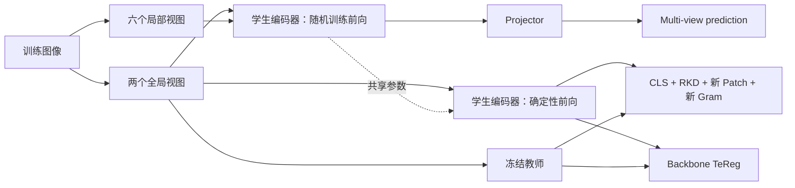

# TeJEPA：以 TeReg 替代 SIGReg 的单阶段教师蒸馏

学生从随机初始化开始，同时学习 JEPA 的多视图目标和冻结教师的语义知识。
训练保留 **2 个 global、6 个 local 视图与 prediction**，用 **TeReg 替代 SIGReg**。
蒸馏使用 CLS、RKD、教师稳定性加权 Patch 和谱压缩 Gram。
原先面向蒸馏阶段的教师适配正则，现在从第一个训练 batch 就与蒸馏一起启用，
不存在先自监督预训练、再切换正则或截取中间 checkpoint 的阶段。
坐标和损失尺度由当前学生与教师重新校准，不需要任何学生预训练权重。

本文描述代码中的候选方法。**该单阶段协议尚无完整 ImageNet 性能结果**，不能将
功能测试或其他初始化方式的结果当作它的准确率，也不声称保证训练收敛或不坍塌。

## 训练结构



确定性学生前向使用 `eval()` 关闭 DropPath，**仍然保留梯度**；结束后恢复训练状态。
基础 JEPA 分支继续使用随机训练前向。教师只处理两个 global 视图，始终冻结。

## 总目标

$$
\begin{aligned}
L_{\mathrm{base}}&=0.95L_{\mathrm{prediction}},\\
L_{\mathrm{KD}}&=L_{\mathrm{CLS}}+L_{\mathrm{RKD}}
+\lambda_p L_{\mathrm{patch}}^{\mathrm{new}}
+\lambda_g L_{\mathrm{Gram}}^{\mathrm{new}},\\
L&=L_{\mathrm{base}}+L_{\mathrm{KD}}+\lambda_TL_{\mathrm{TeReg}}.
\end{aligned}
$$

三种尺度 $\lambda_p,\lambda_g,\lambda_T$ 在当前随机初始化上测量梯度后固定，
不是沿用其他初始化方式拟合的系数。分类标签不进入上述训练目标。

## 保留 JEPA 多视图 prediction

设 $V=8$，$z_i^v$ 是学生第 $v$ 个视图经 projector 得到的未归一化特征，
用两个 global 视图的均值作为中心：

$$
\bar z_i=\tfrac12(z_i^1+z_i^2),\qquad
L_{\mathrm{prediction}}=\frac1{BVD_z}\sum_{i,v}\|z_i^v-\bar z_i\|_2^2.
$$

中心不停止梯度。所有 local 视图参与此项。

正则位置由教师适配的 TeReg 接管，**总目标不再包含独立 SIGReg 项**。
保留局部视图与 prediction，不等于继续使用原标准高斯目标。
代码保留原 LeJEPA 的 backbone/projector 结构，但不实例化 SIGReg 模块；
配置、日志和 checkpoint 也不再含有 SIGReg 权重或状态。

TeReg 作用于 backbone 的固定全维读出，prediction 作用于 projector。
这是一处明确的方法改动，不声称完整继承原 LeJEPA 目标的全部性质。
TeReg 对 backbone 的教师约束，也不构成 projector 非坍塌的数学证明。

## 原有 CLS 与 RKD

设 $h_S,h_T$ 为第一 global 视图的 CLS，$A$ 为可训练的 CLS 对齐头：

$$
L_{\mathrm{CLS}}=\operatorname{MSE}(A(h_S),h_T).
$$

RKD 保留该视图当前 rank 内的图像相似度分布匹配。令 $\hat a_i,\hat t_i$
为归一化 CLS 特征，温度 $\tau=0.1$：

$$
P_S=\operatorname{softmax}(\hat A\hat A^\top/\tau),\quad
P_T=\operatorname{softmax}(\hat T\hat T^\top/\tau),\quad
L_{\mathrm{RKD}}=\tfrac1B\sum_i\operatorname{KL}(P_{T,i}\|P_{S,i}).
$$

保留对角项。改变每卡 batch 会改变 RKD 的统计范围。

## 新 Patch：教师跨视图稳定性加权

学生 patch 经线性头对齐维度，再按教师网格插值，并与教师 patch 一起做 L2
归一化。两个 global 视图记录原图坐标中的裁剪框及翻转标志。

以视图 $a$ 的 patch 中心为锚点，映射回原图，再映射到视图 $b$ 的 token 网格。
在有效插值范围内，用双线性采样获取 $\hat t^b(q),\hat s^b(q)$，并重新归一化。
这给出几何位置对应的近似特征匹配，不声称两个 token 的完整感受野完全相同。

教师可靠性权重为：

$$
w_{iq}=\operatorname{sg}\left[
w_{\min}+(1-w_{\min})
\exp\left(-\frac{1-\langle\hat t_i^a(q),\hat t_i^b(q)\rangle}{\tau_c}\right)
\right],\quad w_{\min}=0.1,\quad\tau_c=0.2.
$$

教师相似度限制在 $[-1,1]$。教师和权重均停止梯度；权重下界避免完全忽略
较不稳定的位置。稳定性只是候选可靠性信号，不等于教师判断正确。

$$
\ell_{iq}=\frac12\sum_{v\in\{a,b\}}
\left[1-\langle\hat s_i^v(q),\hat t_i^v(q)\rangle\right].
$$

将 $a\to b$ 和 $b\to a$ 的有效对应集合合并为 $\Omega_i$，逐图归一化：

$$
L_{\mathrm{patch}}^{\mathrm{new}}
=\frac1B\sum_i\frac{\sum_{q\in\Omega_i}w_{iq}\ell_{iq}}
{\sum_{q\in\Omega_i}w_{iq}}.
$$

如果某张图两个方向均无有效对应，则回退为该图两个视图的均匀 patch 蒸馏。
日志记录有效对应比例、回退比例和有效位置的平均权重。

## 新 Gram：谱压缩后的关系匹配

对每个 global 视图的归一化 patch 矩阵 $\hat S,\hat T$，先构造
$G_S=\hat S\hat S^\top,G_T=\hat T\hat T^\top$。
采用 $\gamma=1/2$ 的平移谱压缩：

$$
C_\delta(G)=(G+\delta I)^{1/2}-\sqrt\delta I,\quad\delta=0.01,
\qquad
\Phi(G)=\frac{C_\delta(G)}{\|C_\delta(G)\|_F+\epsilon}.
$$

$$
L_{\mathrm{Gram}}^{\mathrm{new}}
=\frac1{2B}\sum_{i,v\in\{a,b\}}
\|\Phi(G_{S,i}^v)-\Phi(G_{T,i}^v)\|_F^2.
$$

平方根压缩主谱方向与弱谱方向之间的差距，Frobenius 归一化进一步减少总能量
尺度影响；弱方向也可能包含噪声，因此不预先宣称该压缩一定改善分类。
此处是平方 Frobenius 范数，不再除以 patch 数的平方，需要重新校准权重。

生产计算采用 trace 缩放的 **18 步 Newton–Schulz** 矩阵平方根迭代，避免反传
特征向量。精确分解只用作数值参考。平移平方根的 Fréchet 导数在特征基中的系数为

$$
\frac1{\sqrt{\lambda_i+\delta}+\sqrt{\lambda_j+\delta}},
$$

重复特征值不产生特征向量间隙分母。测试比较了迭代与精确值/导数，但有限精度
迭代并非在所有条件数、维度和数据上都有已证明的误差保证。

## TeReg：教师锚定的联合特征函数匹配

### 固定全维坐标

用训练集中心裁剪提取当前随机学生与教师的配对特征。冻结均值、RMS 标量与
正交 Procrustes 旋转 $R_0$ 后：

$$
S_i=\frac{(h_{S,i}-\mu_{S,0})R_0}{r_{S,0}},\qquad
T_i=\frac{h_{T,i}-\mu_T}{r_T}.
$$

$R_0$ 拟合中心化配对特征的全维正交映射。这里不降维、不白化、不使用学生
批内自适应方差，也没有可训练的 TeReg 读出 MLP。固定正交变换与正标量不会
改变中心化特征的秩，且保留距离几何到统一尺度。

这条读出与 CLS/Patch 的可训练蒸馏头分开。当前实现要求学生、教师 CLS 维度相同。

### 联合目标

独立采样 $\omega\sim\mathcal N(0,I/\sigma_S^2)$、
$\eta\sim\mathcal N(0,I/\sigma_T^2)$，定义

$$
L_{\mathrm{TeReg}}=
\mathbb E_{\omega,\eta}
\left|\frac1N\sum_i e^{\mathrm i\eta^\top T_i}
\left(e^{\mathrm i\omega^\top S_i}-e^{\mathrm i\omega^\top T_i}\right)\right|^2.
$$

带宽在教师训练特征的配对距离上用中位数规则固定。代码每步重新采样 1024 对
频率；频率计数器随 checkpoint 保存，所有 rank 使用相同频率。

其数学含义是比较联合分布 $\mathcal L(S,T)$ 与 $\mathcal L(T,T)$ 的特征函数。
教师锚点保留同图像的配对关系；只比较学生和教师的边缘分布，无法区分样本重排。
学生在共同坐标中匹配教师时，该项恰为零，不要求 backbone 本身为标准高斯。

它等价于乘积 Gaussian 核下的联合 [MMD](https://jmlr.org/papers/v13/gretton12a.html)：

$$
\frac1{N^2}\sum_{i,j}k_T(T_i,T_j)
\left[k_S(S_i,S_j)+k_S(T_i,T_j)-k_S(S_i,T_j)-k_S(T_i,S_j)\right].
$$

有限随机频率近似不保证唯一识别所有分布或样本配对。总体、完整核目标的性质
不能直接当成有限 minibatch 优化的保证。MMD、特征函数比较和谱函数本身并非
新发明；本方法的设计重点是以教师锚定约束替代原标准高斯正则、保留多视图预测，
以及可靠局部监督之间的组合，实际收益仍需实验确认。

### 与原 SIGReg 的关系

TeReg 延续 SIGReg 的特征函数匹配思路，但将标准高斯参考改成教师锚定的联合
分布。**二者是替代关系，不是 SIGReg＋TeReg 叠加。** 教师匹配后 TeReg 为零，
不会继续要求同一表示满足与教师不同的标准高斯目标。

针对蒸馏设计不意味着必须等到某个中间训练阶段才启用。当前协议从随机初始化
就进行蒸馏，因此 TeReg 也从训练开始生效。训练前仅拟合坐标和损失尺度，
不更新 encoder，不构成 Stage1；没有正则切换轮次或延迟启用机制。

## 从随机初始化重新校准

1. 只用训练图像，默认 2000 张中心裁剪，拟合冻结坐标及教师带宽。
2. 在当前模型的两个真实训练 batch 上计算 backbone 梯度，**不创建优化器更新**。
3. Patch 与 Gram 分别匹配均匀余弦、逐元素 Gram-MSE 参考项的初始加权梯度尺度，
   参考预算系数为 0.5 与 0.3；参考项只用于尺度校准，不构成额外训练实验。
4. 将初始 TeReg 梯度限制在新 $L_{\mathrm{KD}}$ 的 10%：

$$
\lambda_T=\min_b
\frac{0.1\,\|\nabla_\theta L_{\mathrm{KD},b}\|}
{\|\nabla_\theta L_{\mathrm{TeReg},b}\|}.
$$

校准后恢复 BN 统计和频率计数，参数不更新；随后系数固定。
这是初始梯度预算，不是之后每步的约束，更不等于 AdamW 实际更新比例。
校准结果保存在 `calibration.json`，读出、权重与频率状态保存在 `last.ckpt`。

## 训练、分布式与评测

- 默认随机 ViT-S/16 学生、冻结 DINOv3 ViT-S/16 教师、一个 seed=0、40 轮。
- AdamW，学习率 $5\times10^{-4}$、weight decay 0.05、5 轮 warmup；本分支 cosine
  horizon 为实际 40 轮。每卡 batch64，8 卡时有效 batch512，不做梯度累积。
- RKD 使用 rank 内统计；TeReg 先可微分收集全局特征，再计算全局目标。
  gather 反向的求和与 DDP 的平均配合，不能额外乘除 world size。
- 只保留原子写入的 rolling `last.ckpt`，包含学生、各头、读出、优化器、计数和
  各 rank RNG 状态；不包含完整教师权重。断点恢复要求相同数据/模型/训练配方。
- 非有限损失或梯度在所有 rank 同步检查，发现后停止，不执行对应优化器更新。
  该简洁版本不包含基于分类准确率的自动熔断，数值有限不代表表示一定有效。
- 下游使用学生 encoder，丢弃 projector 与蒸馏头。冻结最终 CLS 特征后训练
  LayerNorm＋Linear 分类头，30 轮、固定学习率 0.001、最终轮报告；不挑验证集最好轮次。

## 形式化验证的范围

`formal/DistillationLoss.lean` 包含 8 个已通过 Lean 4.19.0 检查的定理：

- 当前有限联合 CF 目标非负，学生投影与教师一致时为零。
- 给定非负逐位置误差，带回退的可靠性加权 Patch 目标非负，零误差时为零。
- 教师可靠性权重在给定参数假设下为正且不超过 1。
- 变换后 Gram 的平方差非负，匹配教师时为零。这里不证明谱变换算法本身。
- 若加权正则梯度范数小于 KD 梯度，则 KD＋该正则之和保留 KD 的一阶下降方向。
  **该结论不覆盖 prediction、有限步长或 AdamW。**

没有使用 `sorry`、`admit` 或自定义公理；通常依赖 `propext`、`Classical.choice`、
`Quot.sound`。它们不证明 Python 浮点实现、矩阵平方根数值算法、完整训练收敛、
非坍塌轨迹或准确率提升。

安装相应 Lean 后可复查：

```bash
cd formal
lake update
lake exe cache get
lake env lean DistillationLoss.lean
```

## 代码验证与方法定位

测试覆盖裁剪/翻转、空交集回退、谱函数梯度、联合 CF 与精确核、分布式梯度、
local-view/projector 梯度、SIGReg 不进入模型/目标/状态、首 batch 即启用 TeReg、
零优化器更新校准、双进程完整训练、断点恢复及
冻结分类入口。测试中的小模型和合成图像只验证实现，不构成分类性能证据。

本分支保留多视图预测，以教师适配 TeReg 替代 SIGReg，不能声称直接继承原 LeJEPA 对另一目标
的全部理论保证。完整从零训练、与相同初始化/预算对照，以及表示分析完成后，
才能判断组合是否有实际收益。

基础资料：[LeJEPA](https://arxiv.org/abs/2511.08544)、
[MMD](https://jmlr.org/papers/v13/gretton12a.html)、
[stable-pretraining](https://github.com/galilai-group/stable-pretraining)、
[DINOv3](https://github.com/facebookresearch/dinov3)。
